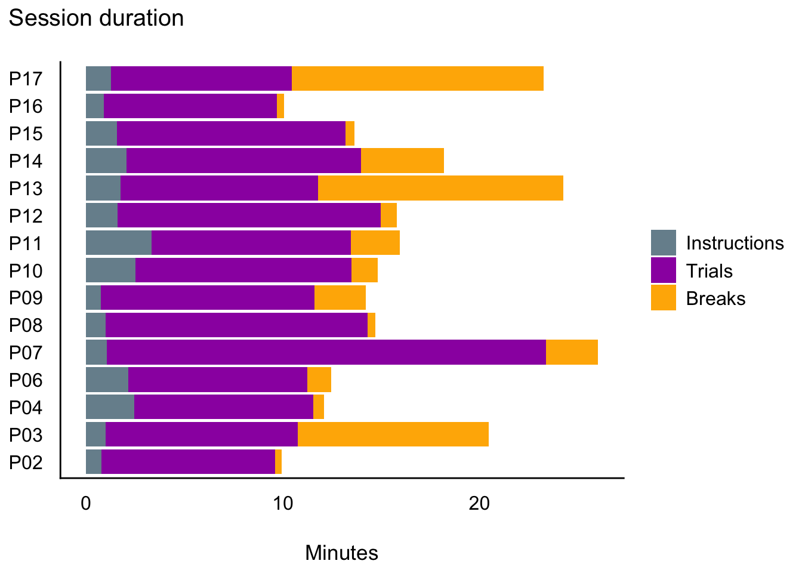
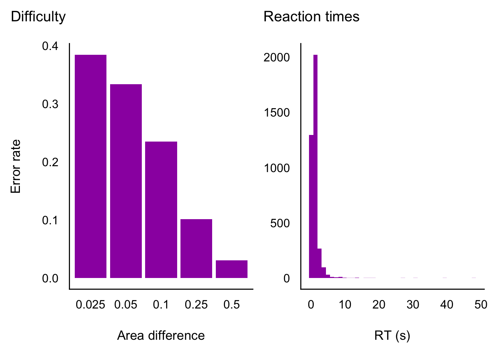
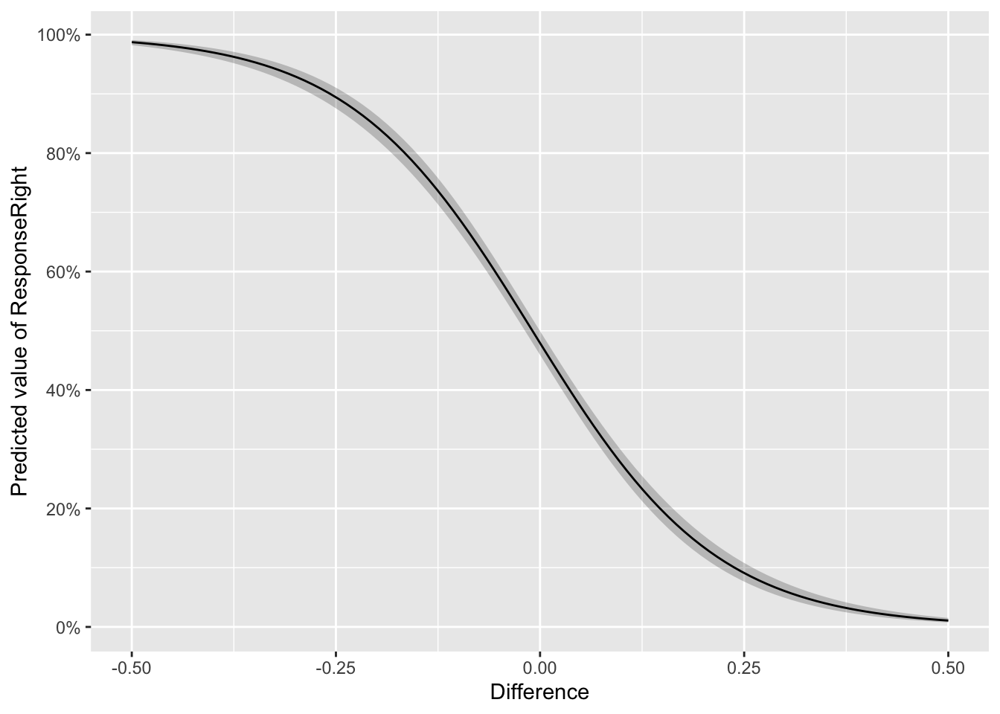
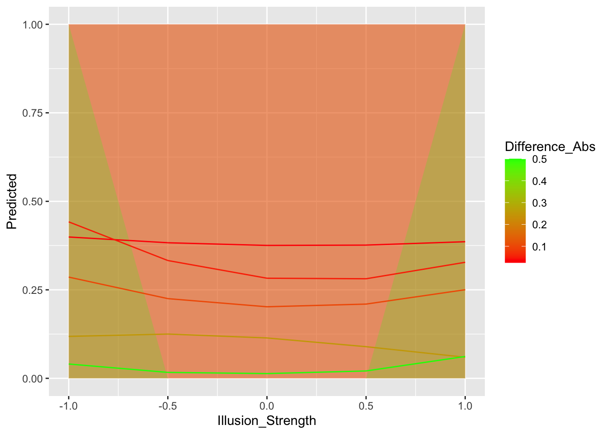
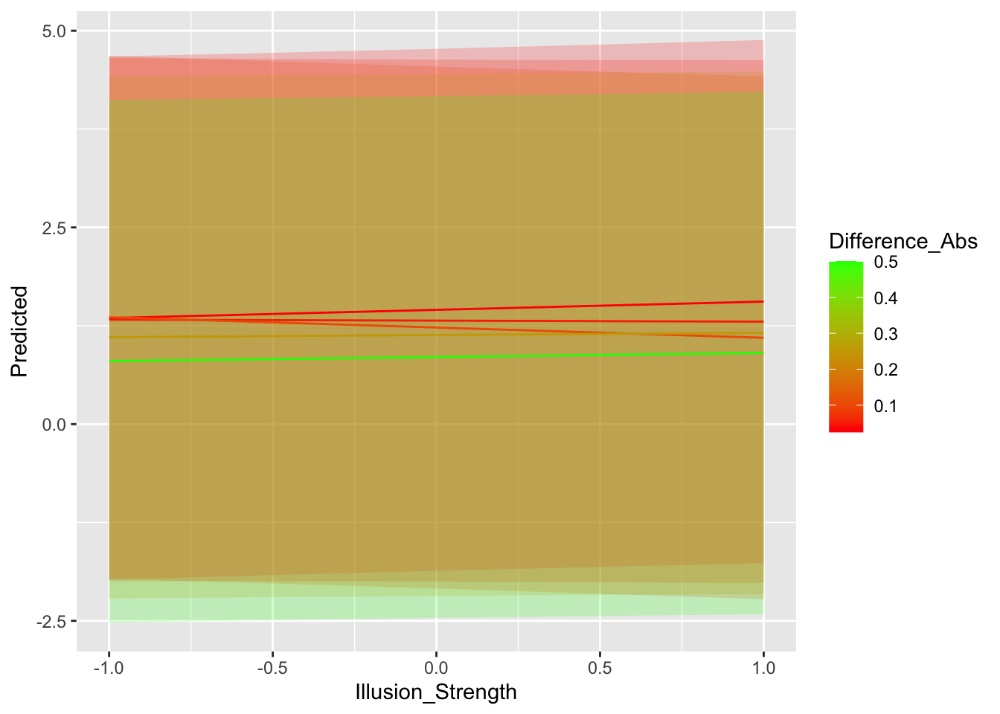
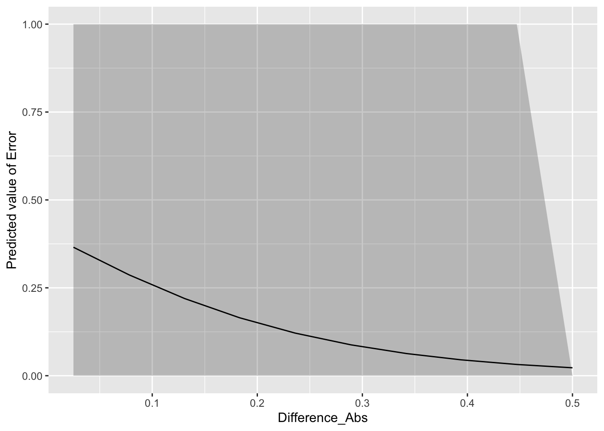

## Packages


::: {.cell}

```{.r .cell-code}
library(jsonlite)
library(tidyverse)
library(easystats)
library(patchwork)
library(lme4)
library(brms)
```
:::


## Data

Each session of the task (`experiment/`) is saved as one JSON container with `session`,
`demographics`, `design` and `trials`. Every trial carries the full Pyllusion parameter
dictionary it was rendered from, so the design does not have to be reconstructed here - it is
read off the trials.

Sessions come from two places: `data/pilots/` (files downloaded from the task's end screen, in
the repo) and `data/raw/` (sessions saved to Zenodo through DataPipe, fetched by
`data/download.py`, git-ignored). Test runs (`test_...`) and the partial files of people who
stopped partway (`....partial.json`, a different format) are left out.


::: {.cell}

```{.r .cell-code  code-fold="false"}
path <- c("../data/pilots", "../data/raw")
```
:::


### Reading one session

The only awkward entries are the colours, which are RGB triplets rather than scalars; they
are collapsed to `"r,g,b"` strings, as the task's own CSV export does. `null` (the
`size_panel` "fill" level, and the tap coordinates of keyboard responses) becomes `NA`.


::: {.cell}

```{.r .cell-code  code-fold="false"}
# One JSON entry -> one value fit for a dataframe column
as_column <- function(x) {
  if (is.null(x) || length(x) == 0) return(NA)
  if (length(x) > 1) return(paste(unlist(x), collapse = ","))  # RGB triplets
  x[[1]]
}

read_session <- function(file) {
  d <- jsonlite::fromJSON(file, simplifyVector = FALSE)

  # One row per trial: the trial-level fields, then the parameter dictionary
  trials <- map(d$trials, function(trial) {
    fields <- trial[setdiff(names(trial), "parameters")]
    as_tibble(map(c(fields, trial$parameters), as_column))
  }) |>
    list_rbind()

  # Session and demographics are constant within a file, so repeat them on every row
  meta <- c(map(d$session, as_column), map(d$demographics, as_column))
  trials |> mutate(!!!meta, .before = 1)
}
```
:::


### All sessions


::: {.cell}

```{.r .cell-code  code-fold="false"}
files <- list.files(path, pattern = "\\.json$", full.names = TRUE)
files <- files[!grepl("\\.partial\\.json$", files) & !startsWith(basename(files), "test_")]
files <- files[!duplicated(basename(files))]

df <- map(files, read_session) |>
  list_rbind() |>
  mutate(
    Participant = paste0("P", str_pad(match(participant_id, unique(participant_id)), 2, pad = "0")),
      # The judged attribute. `Difference` is the signed area difference, positive = left
      # disc is larger; its magnitude is task difficulty and its sign the correct answer.
    Difference_Abs = abs(Difference),
    Difference_Side = if_else(Difference > 0, "Left", "Right"),
    # The illusion. The sign of `Illusion_Strength` says which panel holds the
    # red-leaning disc (>= 0 is left), its magnitude the chromatic separation.
    Red_Side = case_when(
      Illusion_Strength > 0 ~ "Left",
      Illusion_Strength < 0 ~ "Right",
      .default = "None"  # both panels are the same purple
    ),
    # Illusion_Strength = as.factor(Illusion_Strength),
    # Response
    Response = str_remove(response, "Arrow"),
    ResponseRight = Response == "Right",
    Error = !correct,
    RT = rt / 1000,
    ISI = isi / 1000,
    # Screened stimulus factors, as factors
    across(c(Size, Gap, Density, Dither_Size), \(x) factor(x), .names = "{.col}_f"),
    Equiluminant = as.logical(Equiluminant),
    Size_Panel_Mode = factor(Size_Panel_Mode, levels = c("fill", "match")),
    # Recorded but uncontrolled moderators
    age = as.numeric(age)
  )

# Exclude sessions run on an earlier design
current_levels <- c(0.025, 0.05, 0.1, 0.25, 0.5)

design_check <- df |>
  summarise(
    Trials = n(),
    Levels = paste(sort(unique(round(Difference_Abs, 3))), collapse = ", "),
    .by = Participant
  ) |>
  mutate(Current = Levels == paste(current_levels, collapse = ", "))

df <- filter(df, Participant %in% design_check$Participant[design_check$Current])
```
:::


## Sanity checks


::: {.cell}

```{.r .cell-code}
df |>
  summarise(
    Trials = n(),
    Sets = n_distinct(set),
    Blocks = n_distinct(block),
    Accuracy = mean(correct),
    RT_median = median(RT),
    # ISO 8601 with a "Z": as.POSIXct() silently keeps only the date, ymd_hms() does not
    Duration_min = as.numeric(difftime(ymd_hms(end_time[1]), ymd_hms(start_time[1]), units = "mins")),
    .by = Participant
  ) |>
  display()
```

::: {.cell-output-display}


|Participant | Trials| Sets| Blocks| Accuracy| RT_median| Duration_min|
|:-----------|------:|----:|------:|--------:|---------:|------------:|
|P02         |    250|   10|      4|     0.72|      0.54|         9.96|
|P03         |    250|   10|      4|     0.80|      0.60|        20.45|
|P04         |    250|   10|      4|     0.75|      0.57|        12.08|
|P06         |    250|   10|      4|     0.69|      0.56|        12.44|
|P07         |    250|   10|      4|     0.90|      2.65|        26.02|
|P08         |    250|   10|      4|     0.78|      1.46|        14.70|
|P09         |    250|   10|      4|     0.79|      0.90|        14.23|
|P10         |    250|   10|      4|     0.72|      0.94|        14.82|
|P11         |    250|   10|      4|     0.84|      0.83|        16.45|
|P12         |    250|   10|      4|     0.74|      1.44|        15.79|
|P13         |    250|   10|      4|     0.75|      0.82|        24.24|
|P14         |    250|   10|      4|     0.82|      0.96|        18.20|
|P15         |    250|   10|      4|     0.88|      0.89|        13.62|
|P16         |    250|   10|      4|     0.77|      0.53|        10.05|
|P17         |    250|   10|      4|     0.79|      0.51|        23.26|


:::
:::


Design balance. The difficulty x strength grid is crossed exactly, so every cell should
appear once per set - i.e. `n_sets` times:


::: {.cell}

```{.r .cell-code}
df |>
  count(Illusion_Strength, Difference_Abs) |>
  pivot_wider(names_from = Difference_Abs, values_from = n, names_sort = TRUE) |>
  display()
```

::: {.cell-output-display}


|Illusion_Strength | 0.025| 0.05|0.1 | 0.25|0.5 |
|:-----------------|-----:|----:|:---|----:|:---|
|-1.00             |   150|  150|150 |  150|150 |
|-0.50             |   150|  150|150 |  150|150 |
|0.00              |   150|  150|150 |  150|150 |
|0.50              |   150|  150|150 |  150|150 |
|1.00              |   150|  150|150 |  150|150 |


:::
:::


The sign of the difference is balanced *within* each strength level, so these should be
close to half and half rather than exact:


::: {.cell}

```{.r .cell-code}
df |>
  count(Illusion_Strength, Difference_Side) |>
  pivot_wider(names_from = Difference_Side, values_from = n) |>
  display()
```

::: {.cell-output-display}


|Illusion_Strength | Left| Right|
|:-----------------|----:|-----:|
|-1.00             |  371|   379|
|-0.50             |  379|   371|
|0.00              |  368|   382|
|0.50              |  385|   365|
|1.00              |  382|   368|


:::
:::


The screened factors are assigned by balanced randomisation, so each level should be close
to equally frequent (exactly so for the two-level ones):


::: {.cell}

```{.r .cell-code}
map(
  c("Size", "Gap", "Density", "Dither_Size", "Equiluminant", "Size_Panel_Mode"),
  \(f) {
    df |>
      count(.data[[f]]) |>
      rename(Level = 1) |>
      mutate(Factor = f, Level = as.character(Level), .before = 1)
  }
) |>
  list_rbind() |>
  display()
```

::: {.cell-output-display}


|Factor          | Level|   n |
|:---------------|-----:|:----|
|Size            |  0.25|1249 |
|Size            |   0.5|1246 |
|Size            |  0.75|1255 |
|Gap             |     0|1245 |
|Gap             |  0.02|1245 |
|Gap             |  0.06|1260 |
|Density         |   0.5|1258 |
|Density         |  0.75|1246 |
|Density         |     1|1246 |
|Dither_Size     |     2|1241 |
|Dither_Size     |     4|1251 |
|Dither_Size     |     8|1258 |
|Equiluminant    | FALSE|1873 |
|Equiluminant    |  TRUE|1877 |
|Size_Panel_Mode |  fill|1871 |
|Size_Panel_Mode | match|1879 |


:::
:::


## Duration

How long the task actually takes, which is what the session length (`n_sets`) has to be set
against. Two clocks are logged and they line up: `start_time` / `end_time` are wall clock
(ISO, UTC), while `stimulus_onset` is `performance.now()`, i.e. milliseconds since the page
loaded. Since the page loads at `start_time`, the two can be combined to split the session
into its parts.


::: {.cell}

```{.r .cell-code  code-fold="false"}
durations <- df |>
  arrange(Participant, order) |>
  mutate(
    trial_end = stimulus_onset + rt,  # ms since page load
    gap = (stimulus_onset - lag(trial_end)) / 1000,
    after_break = block != lag(block, default = first(block)),
    .by = Participant
  ) |>
  summarise(
    Trials = n(),
    Total = as.numeric(difftime(ymd_hms(end_time[1]), ymd_hms(start_time[1]), units = "mins")),
    Instructions = first(stimulus_onset) / 60000,
    Breaks = sum(gap[after_break], na.rm = TRUE) / 60,
    Task = (last(trial_end) - first(stimulus_onset)) / 60000,
    .by = Participant
  ) |>
  mutate(
    Trials_time = Task - Breaks,
    Sec_per_trial = Trials_time * 60 / Trials,
    Residual = (Total - Instructions - Trials_time - Breaks) * 60
  )

durations |>
  select(Participant, Trials, Total, Instructions, Trials_time, Breaks, Sec_per_trial, Residual) |>
  display()
```

::: {.cell-output-display}


|Participant | Trials| Total| Instructions| Trials_time| Breaks| Sec_per_trial| Residual|
|:-----------|------:|-----:|------------:|-----------:|------:|-------------:|--------:|
|P02         |    250|  9.96|         0.79|        8.81|   0.35|          2.11|     0.67|
|P03         |    250| 20.45|         0.99|        9.77|   9.69|          2.34|    -0.10|
|P04         |    250| 12.08|         2.45|        9.08|   0.54|          2.18|     0.19|
|P06         |    250| 12.44|         2.15|        9.10|   1.20|          2.18|    -0.14|
|P07         |    250| 26.02|         1.04|       22.33|   2.64|          5.36|     0.21|
|P08         |    250| 14.70|         0.98|       13.33|   0.38|          3.20|     0.31|
|P09         |    250| 14.23|         0.76|       10.83|   2.64|          2.60|    -0.02|
|P10         |    250| 14.82|         2.52|       10.97|   1.33|          2.63|     0.05|
|P11         |    250| 16.45|         3.32|       10.15|   2.47|          2.43|    30.88|
|P12         |    250| 15.79|         1.61|       13.36|   0.82|          3.21|    -0.09|
|P13         |    250| 24.24|         1.74|       10.04|  12.46|          2.41|     0.35|
|P14         |    250| 18.20|         2.05|       11.93|   4.22|          2.86|     0.38|
|P15         |    250| 13.62|         1.56|       11.62|   0.45|          2.79|    -0.21|
|P16         |    250| 10.05|         0.90|        8.80|   0.36|          2.11|    -0.77|
|P17         |    250| 23.26|         1.27|        9.20|  12.79|          2.21|     0.30|


:::
:::


::: {.cell}

```{.r .cell-code}
durations |>
  summarise(across(
    c(Total, Instructions, Trials_time, Breaks, Sec_per_trial),
    list(mean = mean, min = min, max = max)
  )) |>
  pivot_longer(everything(), names_to = c("Part", "Stat"), names_pattern = "(.*)_(mean|min|max)") |>
  pivot_wider(names_from = Stat, values_from = value) |>
  display()
```

::: {.cell-output-display}


|Part          | mean | min |  max |
|:-------------|:-----|:----|:-----|
|Total         |16.42 |9.96 |26.02 |
|Instructions  | 1.61 |0.76 | 3.32 |
|Trials_time   |11.29 |8.80 |22.33 |
|Breaks        | 3.49 |0.35 |12.79 |
|Sec_per_trial | 2.71 |2.11 | 5.36 |


:::
:::


Composition of each session:


::: {.cell}

```{.r .cell-code}
durations |>
  select(Participant, Instructions, Trials_time, Breaks) |>
  pivot_longer(-Participant, names_to = "Part", values_to = "Minutes") |>
  mutate(Part = factor(
    Part,
    levels = c("Instructions", "Trials_time", "Breaks"),
    labels = c("Instructions", "Trials", "Breaks")
  )) |>
  ggplot(aes(x = Participant, y = Minutes, fill = Part)) +
  # reverse = TRUE so the parts read in chronological order once flipped
  geom_bar(stat = "identity", position = position_stack(reverse = TRUE)) +
  scale_fill_manual(values = c(Instructions = "#78909C", Trials = "#9C27B0", Breaks = "#FFB300")) +
  labs(x = NULL, y = "Minutes", fill = NULL, title = "Session duration") +
  coord_flip() +
  theme_modern()
```

::: {.cell-output-display}
{width=672}
:::
:::


Per block, to see whether people slow down or speed up as the session goes on. `Break_after`
is the self-paced break screen that followed the block.


::: {.cell}

```{.r .cell-code}
by_trial <- df |>
  arrange(Participant, order) |>
  mutate(
    trial_end = stimulus_onset + rt,
    gap = (stimulus_onset - lag(trial_end)) / 1000,
    prev_block = lag(block),
    .by = Participant
  )

# The break that followed a block is the gap sitting on the first trial of the next one
breaks <- by_trial |>
  filter(block != prev_block) |>
  select(Participant, block = prev_block, Break_after = gap)

by_trial |>
  summarise(
    Trials = n(),
    Minutes = (last(trial_end) - first(stimulus_onset)) / 60000,
    RT_median = median(RT),
    Error = mean(Error),
    .by = c(Participant, block)
  ) |>
  left_join(breaks, by = c("Participant", "block")) |>
  display()
```

::: {.cell-output-display}


|Participant | block| Trials| Minutes| RT_median| Error| Break_after|
|:-----------|-----:|------:|-------:|---------:|-----:|-----------:|
|P02         |     1|     63|    2.29|      0.58|  0.29|       11.57|
|P02         |     2|     63|    2.20|      0.51|  0.27|        5.41|
|P02         |     3|     63|    2.20|      0.53|  0.27|        4.26|
|P02         |     4|     61|    2.12|      0.54|  0.31|            |
|P03         |     1|     63|    2.54|      0.76|  0.22|       16.61|
|P03         |     2|     63|    2.76|      0.73|  0.16|      510.38|
|P03         |     3|     63|    2.28|      0.54|  0.29|       54.41|
|P03         |     4|     61|    2.18|      0.53|  0.13|            |
|P04         |     1|     63|    2.29|      0.58|  0.22|        9.11|
|P04         |     2|     63|    2.22|      0.51|  0.32|       20.83|
|P04         |     3|     63|    2.33|      0.58|  0.22|        2.72|
|P04         |     4|     61|    2.24|      0.60|  0.25|            |
|P06         |     1|     63|    2.32|      0.56|  0.30|       18.03|
|P06         |     2|     63|    2.31|      0.56|  0.32|       34.07|
|P06         |     3|     63|    2.27|      0.56|  0.35|       19.90|
|P06         |     4|     61|    2.20|      0.55|  0.26|            |
|P07         |     1|     63|    6.15|      2.51|  0.11|       73.05|
|P07         |     2|     63|    5.28|      2.65|  0.14|        4.90|
|P07         |     3|     63|    5.90|      3.38|  0.05|       80.47|
|P07         |     4|     61|    5.01|      2.42|  0.11|            |
|P08         |     1|     63|    3.40|      1.51|  0.21|        7.95|
|P08         |     2|     63|    3.33|      1.40|  0.21|        3.91|
|P08         |     3|     63|    3.59|      1.76|  0.24|       11.07|
|P08         |     4|     61|    3.01|      1.33|  0.23|            |
|P09         |     1|     63|    2.66|      0.87|  0.16|       25.16|
|P09         |     2|     63|    2.88|      1.00|  0.21|       90.21|
|P09         |     3|     63|    2.74|      1.05|  0.21|       42.76|
|P09         |     4|     61|    2.55|      0.84|  0.26|            |
|P10         |     1|     63|    2.86|      1.01|  0.24|       23.03|
|P10         |     2|     63|    2.66|      0.88|  0.27|       28.17|
|P10         |     3|     63|    2.75|      0.89|  0.33|       28.75|
|P10         |     4|     61|    2.70|      0.99|  0.26|            |
|P11         |     1|     63|    2.57|      0.82|  0.17|       41.41|
|P11         |     2|     63|    2.62|      0.93|  0.10|       48.25|
|P11         |     3|     63|    2.53|      0.78|  0.21|       58.64|
|P11         |     4|     61|    2.42|      0.80|  0.15|            |
|P12         |     1|     63|    3.36|      1.52|  0.24|       17.08|
|P12         |     2|     63|    3.35|      1.47|  0.33|       27.14|
|P12         |     3|     63|    3.51|      1.58|  0.24|        5.12|
|P12         |     4|     61|    3.15|      1.29|  0.21|            |
|P13         |     1|     63|    2.67|      0.90|  0.27|      203.79|
|P13         |     2|     63|    2.44|      0.75|  0.22|      127.57|
|P13         |     3|     63|    2.55|      0.89|  0.19|      415.99|
|P13         |     4|     61|    2.38|      0.73|  0.31|            |
|P14         |     1|     63|    3.01|      1.09|  0.16|      124.19|
|P14         |     2|     63|    2.72|      0.92|  0.19|      125.58|
|P14         |     3|     63|    2.64|      0.88|  0.19|        3.43|
|P14         |     4|     61|    3.55|      1.03|  0.18|            |
|P15         |     1|     63|    2.84|      0.94|  0.10|        9.45|
|P15         |     2|     63|    2.54|      0.74|  0.19|        8.11|
|P15         |     3|     63|    2.88|      0.75|  0.13|        9.18|
|P15         |     4|     61|    3.37|      1.43|  0.08|            |
|P16         |     1|     63|    2.21|      0.54|  0.24|       10.19|
|P16         |     2|     63|    2.24|      0.51|  0.22|        6.00|
|P16         |     3|     63|    2.15|      0.51|  0.22|        5.22|
|P16         |     4|     61|    2.21|      0.57|  0.23|            |
|P17         |     1|     63|    2.31|      0.51|  0.13|       54.74|
|P17         |     2|     63|    2.31|      0.52|  0.25|      628.16|
|P17         |     3|     63|    2.38|      0.46|  0.21|       84.34|
|P17         |     4|     61|    2.20|      0.51|  0.25|            |


:::
:::


At 2.7 s per trial, a set of 20 trials costs about
0.9 min of trial time, so `n_sets` can be
priced directly: the instruction phase is a fixed overhead on top, and the breaks are
self-paced.

## Overview


::: {.cell}

```{.r .cell-code}
p1 <- df |>
  summarise(Error = mean(Error), .by = c(Difference_Abs)) |>
  ggplot(aes(x = factor(Difference_Abs), y = Error)) +
  geom_bar(stat = "identity", fill = "#9C27B0") +
  labs(x = "Area difference", y = "Error rate", title = "Difficulty") +
  theme_modern()

p2 <- df |>
  ggplot(aes(x = RT)) +
  geom_histogram(bins = 40, fill = "#9C27B0") +
  labs(x = "RT (s)", y = NULL, title = "Reaction times") +
  theme_modern()

p1 | p2
```

::: {.cell-output-display}
{width=672}
:::
:::


::: {.cell}

```{.r .cell-code}
m <- glm(ResponseRight ~ Difference, data = df, family = "binomial")

estimate_relation(m, length = 100) |> 
  plot()
```

::: {.cell-output-display}
{width=672}
:::
:::


## Models


::: {.cell}

```{.r .cell-code}
m <- glm(Error ~ poly(Illusion_Strength, 2) * as.factor(Difference_Abs),
         data = df, family = "binomial")

estimate_prediction(m) |> 
  filter(Difference_Abs < 1) |> 
  mutate(Illusion_Strength = as.numeric(as.character(Illusion_Strength))) |> 
  ggplot(aes(x=Illusion_Strength, y = Predicted, group = Difference_Abs)) +
  geom_ribbon(aes(fill = Difference_Abs, ymin = CI_low, ymax= CI_high), alpha = 0.2) +
  geom_line(aes(color = Difference_Abs)) +
  scale_color_gradient(low = "red", high = "green") +
  scale_fill_gradient(low = "red", high = "green")
```

::: {.cell-output-display}
{width=672}
:::
:::


::: {.cell}

```{.r .cell-code}
m <- lm(RT ~ Illusion_Strength * as.factor(Difference_Abs), 
        data = filter(df, Error == FALSE))

estimate_prediction(m) |> 
  filter(Difference_Abs < 1) |> 
  mutate(Illusion_Strength = as.numeric(as.character(Illusion_Strength))) |> 
  ggplot(aes(x=Illusion_Strength, y = Predicted, group = Difference_Abs)) +
  geom_ribbon(aes(fill = Difference_Abs, ymin = CI_low, ymax= CI_high), alpha = 0.2) +
  geom_line(aes(color = Difference_Abs)) +
  scale_color_gradient(low = "red", high = "green") +
  scale_fill_gradient(low = "red", high = "green")
```

::: {.cell-output-display}
{width=672}
:::
:::


## Modulation


::: {.cell}

```{.r .cell-code}
rez <- data.frame()
for(var in c("Illusion_Strength" ,"Equiluminant", "Size", "Gap", "Density", "Dither_Size", "Size_Panel")) {
  if(!var %in% c("Size_Panel", "Illusion_Strength")) {
    var <- paste0("as.factor(", var, ")")
  }
  f <- paste0("Error ~ Difference_Abs * ", var)
  m <- glm(f, family = "binomial", data = df)
  rez <- parameters(m) |>
    as.data.frame() |> 
    tail(n = 2) |> 
    mutate(Variable = var) |> 
    select(Variable, Parameter, Coefficient, p) |> 
    rbind(rez)
}
arrange(rez, p)
```
:::


::: {.cell}

```{.r .cell-code}
m <- glm(Error ~ Difference_Abs,
         data = df, family = "binomial")

estimate_prediction(m, by = "Difference_Abs") |> 
  plot()
```

::: {.cell-output-display}
{width=672}
:::
:::


## Summary stats

#### Sample size


::: {.cell}

```{.r .cell-code}
df |>
  summarise(Participants = n_distinct(Participant),
            Trials = n(),
            Trials_per_person = n() / n_distinct(Participant)) |>
  display()
```

::: {.cell-output-display}


|Participants | Trials| Trials_per_person|
|:------------|------:|-----------------:|
|15           |   3750|               250|


:::
:::


#### Accuracy 

Accuracy when the red disc is the truly larger or smaller one, against the baseline (both panels purple, no red/blue contrast):


::: {.cell}

```{.r .cell-code}
df |>
  mutate(
    Red_Is = case_when(
      Red_Side == "None"          ~ "Purple (no red/blue contrast)",
      Red_Side == Difference_Side ~ "Red larger",
      .default                    = "Red smaller"
    )
  ) |>
  summarise(Trials = n(), Correct = mean(correct), .by = Red_Is) |>
  display()
```

::: {.cell-output-display}


|Red_Is                        | Trials| Correct|
|:-----------------------------|------:|-------:|
|Purple (no red/blue contrast) |    750|    0.80|
|Red smaller                   |   1483|    0.83|
|Red larger                    |   1517|    0.74|


:::
:::


Accuracy per participant (positive `Diff` means more accurate when red is smaller):


::: {.cell}

```{.r .cell-code}
df |>
  filter(Red_Side != "None") |>
  mutate(Red_Is = if_else(Red_Side == Difference_Side, "Larger", "Smaller")) |>
  summarise(Correct = mean(correct), .by = c(Participant, Red_Is)) |>
  pivot_wider(names_from = Red_Is, values_from = Correct, names_prefix = "Red_") |>
  mutate(Diff = Red_Smaller - Red_Larger) |>
  display()
```

::: {.cell-output-display}


|Participant | Red_Smaller| Red_Larger|  Diff|
|:-----------|-----------:|----------:|-----:|
|P02         |        0.77|       0.64|  0.13|
|P03         |        0.77|       0.81| -0.04|
|P04         |        0.81|       0.69|  0.12|
|P06         |        0.94|       0.42|  0.52|
|P07         |        0.88|       0.93| -0.05|
|P08         |        0.80|       0.75|  0.05|
|P09         |        0.88|       0.68|  0.20|
|P10         |        0.71|       0.75| -0.05|
|P11         |        0.87|       0.86|  0.02|
|P12         |        0.82|       0.66|  0.16|
|P13         |        0.84|       0.67|  0.18|
|P14         |        0.92|       0.73|  0.19|
|P15         |        0.87|       0.89| -0.02|
|P16         |        0.86|       0.69|  0.17|
|P17         |        0.68|       0.88| -0.20|


:::
:::


## Mixed-effects models

Logistic mixed models of the response (`ResponseRight`). A positive `Illusion_Strength` coefficient means the red disc is judged smaller. Random slopes model between-participant variation in sensitivity to area difference and illusion strength.

### Preparation


::: {.cell}

```{.r .cell-code}
df <- df |>
  mutate(
    Difference_10pct = Difference / 0.1,             # area difference, in units of 10%
    Illusion_Strength_f = factor(Illusion_Strength)  # categorical version
  )

ctrl <- glmerControl(optimizer = "bobyqa", optCtrl = list(maxfun = 2e5))
```
:::


### Core model

Singular-fit check: `FALSE` is fine. If `TRUE`, refit with uncorrelated random effects.


::: {.cell}

```{.r .cell-code}
m_core <- glmer(
  ResponseRight ~ Difference_10pct + Illusion_Strength +
    (1 + Difference_10pct + Illusion_Strength | Participant),
  data = df, family = binomial, control = ctrl
)

isSingular(m_core)
```

::: {.cell-output .cell-output-stdout}

```
[1] FALSE
```


:::

```{.r .cell-code}
parameters(m_core)
```

::: {.cell-output .cell-output-stdout}

```
# Fixed Effects

Parameter         | Log-Odds |   SE |         95% CI |     z |      p
---------------------------------------------------------------------
(Intercept)       |    -0.10 | 0.11 | [-0.33,  0.12] | -0.88 | 0.377 
Difference 10pct  |    -1.17 | 0.14 | [-1.44, -0.89] | -8.24 | < .001
Illusion Strength |     0.42 | 0.20 | [ 0.02,  0.82] |  2.05 | 0.040 

# Random Effects

Parameter                                             | Coefficient
-------------------------------------------------------------------
SD (Intercept: Participant)                           |        0.41
SD (Difference_10pct: Participant)                    |        0.51
SD (Illusion_Strength: Participant)                   |        0.75
Cor (Intercept~Difference_10pct: Participant)         |        0.19
Cor (Intercept~Illusion_Strength: Participant)        |       -0.25
Cor (Difference_10pct~Illusion_Strength: Participant) |        0.28
```


:::

::: {.cell-output .cell-output-stderr}

```

Uncertainty intervals (equal-tailed) and p-values (two-tailed) computed
  using a Wald z-distribution approximation.
```


:::

::: {.cell-output .cell-output-stderr}

```

The model has a log- or logit-link. Consider using `exponentiate =
  TRUE` to interpret coefficients as ratios.
```


:::
:::


Wald p-values are optimistic with few participants. The likelihood-ratio test and bootstrap below are more reliable checks.

Likelihood-ratio test of `Illusion_Strength`: compares the model with and without it. A small `Pr(>Chisq)` indicates a better fit than expected by chance when it is included.


::: {.cell}

```{.r .cell-code}
m_null <- update(m_core, . ~ . - Illusion_Strength)
anova(m_null, m_core)
```

::: {.cell-output .cell-output-stdout}

```
Data: df
Models:
m_null: ResponseRight ~ Difference_10pct + (1 + Difference_10pct + Illusion_Strength | Participant)
m_core: ResponseRight ~ Difference_10pct + Illusion_Strength + (1 + Difference_10pct + Illusion_Strength | Participant)
       npar    AIC    BIC  logLik -2*log(L) Chisq Df Pr(>Chisq)  
m_null    8 3249.0 3298.8 -1616.5    3233.0                      
m_core    9 3247.3 3303.3 -1614.6    3229.3 3.718  1    0.05383 .
---
Signif. codes:  0 '***' 0.001 '**' 0.01 '*' 0.05 '.' 0.1 ' ' 1
```


:::
:::


Bootstrap 95% confidence intervals for the fixed effects (500 simulations).


::: {.cell}

```{.r .cell-code}
set.seed(123)
confint(m_core, method = "boot", nsim = 500, parm = "beta_")
```

::: {.cell-output .cell-output-stderr}

```
Computing bootstrap confidence intervals ...
```


:::

::: {.cell-output .cell-output-stderr}

```

10 message(s): boundary (singular) fit: see help('isSingular')
2 warning(s): Model failed to converge with max|grad| = 0.0613804 (tol = 0.002, component 1)
  See ?lme4::convergence and ?lme4::troubleshooting. (and others)
```


:::

::: {.cell-output .cell-output-stdout}

```
                        2.5 %     97.5 %
(Intercept)       -0.35468423  0.1184665
Difference_10pct  -1.45758999 -0.9082146
Illusion_Strength  0.04796233  0.8189996
```


:::
:::


### Individual differences

Each point shows one participant’s estimated illusion effect from the mixed model (log-odds per unit of illusion strength). Positive values suggest a bias towards judging the red disc as smaller than the blue disc. Negative values suggest a bias in the opposite direction.


::: {.cell}

```{.r .cell-code}
ind <- coef(m_core)$Participant |>
  rownames_to_column("Participant") |>
  transmute(Participant, Slope = Illusion_Strength)

ind |>
  ggplot(aes(x = reorder(Participant, Slope), y = Slope)) +
  geom_hline(yintercept = 0, linetype = "dashed") +
  geom_point(size = 3, color = "#9C27B0") +
  coord_flip() +
  labs(x = NULL, y = "Illusion effect (log-odds per unit of illusion strength)") +
  theme_modern()
```

::: {.cell-output-display}
{width=672}
:::
:::


### Linear vs categorical illusion strength

Tests whether treating illusion strength as categorical improves on a linear term (likelihood-ratio test; lower AIC/BIC indicates a better fit after penalising complexity). If it doesn’t, the linear term is adequate.


::: {.cell}

```{.r .cell-code}
m_cat <- update(m_core, . ~ . - Illusion_Strength + Illusion_Strength_f)
anova(m_core, m_cat)
```

::: {.cell-output .cell-output-stdout}

```
Data: df
Models:
m_core: ResponseRight ~ Difference_10pct + Illusion_Strength + (1 + Difference_10pct + Illusion_Strength | Participant)
m_cat: ResponseRight ~ Difference_10pct + (1 + Difference_10pct + Illusion_Strength | Participant) + Illusion_Strength_f
       npar    AIC    BIC  logLik -2*log(L)  Chisq Df Pr(>Chisq)
m_core    9 3247.3 3303.3 -1614.6    3229.3                     
m_cat    12 3253.2 3328.0 -1614.6    3229.2 0.0322  3     0.9985
```


:::
:::


### Moderators

Each factor is included as a main effect plus its interaction with `Illusion_Strength`. The likelihood-ratio test compares this against the model without the interaction. p-values are corrected across the 6 factors using Holm, Bonferroni and Benjamini-Hochberg methods.


::: {.cell}

```{.r .cell-code}
factors <- c("Size_f", "Gap_f", "Density_f", "Dither_Size_f",
             "Equiluminant", "Size_Panel_Mode")

moderators <- map(factors, \(f) {
  m0 <- update(m_core, as.formula(paste(". ~ . +", f)))
  m1 <- update(m_core, as.formula(paste(". ~ . +", f, "+ Illusion_Strength:", f)))
  a <- anova(m0, m1)
  tibble(Factor = f, Chisq = a$Chisq[2], df = a$Df[2], p = a$`Pr(>Chisq)`[2])
}) |>
  list_rbind() |>
  mutate(
    p_holm = p.adjust(p, method = "holm"),
    p_bonferroni = p.adjust(p, method = "bonferroni"),
    p_bh = p.adjust(p, method = "BH")
  )

display(moderators)
```

::: {.cell-output-display}


|Factor          | Chisq| df|   p | p_holm| p_bonferroni|p_bh |
|:---------------|-----:|--:|:----|------:|------------:|:----|
|Size_f          |  3.14|  2|0.21 |   1.00|         1.00|0.62 |
|Gap_f           |  0.88|  2|0.64 |   1.00|         1.00|0.77 |
|Density_f       |  0.38|  2|0.83 |   1.00|         1.00|0.83 |
|Dither_Size_f   |  8.98|  2|0.01 |   0.07|         0.07|0.07 |
|Equiluminant    |  0.31|  1|0.58 |   1.00|         1.00|0.77 |
|Size_Panel_Mode |  0.84|  1|0.36 |   1.00|         1.00|0.72 |


:::
:::


### Illusion effect by factor level

The marginal effect of `Illusion_Strength` at each level of each factor, i.e. the change in the probability of a right-hand response per unit of illusion strength. Descriptive only - moderator tests above show whether levels differ.


::: {.cell}

```{.r .cell-code}
for (f in factors) {
  m1 <- update(m_core, as.formula(paste(". ~ . +", f, "+ Illusion_Strength:", f)))
  print(estimate_slopes(m1, trend = "Illusion_Strength", by = f))
}
```

::: {.cell-output .cell-output-stdout}

```
Estimated Marginal Effects

Size_f | Slope |   SE |        95% CI |    z |     p
----------------------------------------------------
0.25   |  0.14 | 0.05 | [ 0.03, 0.24] | 2.61 | 0.009
0.5    |  0.08 | 0.05 | [-0.02, 0.19] | 1.58 | 0.114
0.75   |  0.08 | 0.05 | [-0.02, 0.18] | 1.49 | 0.137

Marginal effects estimated for Illusion_Strength
Type of slope was dY/dXEstimated Marginal Effects

Gap_f | Slope |   SE |        95% CI |    z |     p
---------------------------------------------------
0     |  0.12 | 0.05 | [ 0.01, 0.22] | 2.22 | 0.027
0.02  |  0.10 | 0.05 | [-0.01, 0.20] | 1.81 | 0.070
0.06  |  0.08 | 0.05 | [-0.02, 0.19] | 1.50 | 0.132

Marginal effects estimated for Illusion_Strength
Type of slope was dY/dXEstimated Marginal Effects

Density_f | Slope |   SE |        95% CI |    z |     p
-------------------------------------------------------
0.5       |  0.10 | 0.05 | [ 0.00, 0.21] | 1.95 | 0.051
0.75      |  0.08 | 0.05 | [-0.02, 0.19] | 1.60 | 0.110
1         |  0.11 | 0.05 | [ 0.00, 0.21] | 2.02 | 0.044

Marginal effects estimated for Illusion_Strength
Type of slope was dY/dXEstimated Marginal Effects

Dither_Size_f | Slope |   SE |        95% CI |    z |     p
-----------------------------------------------------------
2             |  0.03 | 0.05 | [-0.07, 0.14] | 0.64 | 0.523
4             |  0.13 | 0.05 | [ 0.03, 0.24] | 2.46 | 0.014
8             |  0.13 | 0.05 | [ 0.03, 0.24] | 2.48 | 0.013

Marginal effects estimated for Illusion_Strength
Type of slope was dY/dXEstimated Marginal Effects

Equiluminant | Slope |   SE |        95% CI |    z |     p
----------------------------------------------------------
FALSE        |  0.09 | 0.05 | [-0.01, 0.19] | 1.80 | 0.072
TRUE         |  0.11 | 0.05 | [ 0.01, 0.21] | 2.13 | 0.034

Marginal effects estimated for Illusion_Strength
Type of slope was dY/dXEstimated Marginal Effects

Size_Panel_Mode | Slope |   SE |        95% CI |    z |     p
-------------------------------------------------------------
fill            |  0.09 | 0.05 | [-0.01, 0.19] | 1.71 | 0.088
match           |  0.11 | 0.05 | [ 0.01, 0.21] | 2.23 | 0.026

Marginal effects estimated for Illusion_Strength
Type of slope was dY/dX
```


:::
:::


### Bayesian core model

Bayesian version of the core model, with weakly informative priors (wide normal on effects, exponential on random-effect SDs). Used as a cross-check on the mixed model above.


::: {.cell}

```{.r .cell-code}
m_bayes <- brm(
  ResponseRight ~ Difference_10pct + Illusion_Strength +
    (1 + Difference_10pct + Illusion_Strength | Participant),
  data = df, family = bernoulli(),
  prior = c(prior(normal(0, 2), class = b),
            prior(exponential(1), class = sd)),
  chains = 4, cores = 4, seed = 123,
  refresh = 0, silent = 2
)
```
:::


::: {.cell}

```{.r .cell-code}
describe_posterior(m_bayes, test = "pd")
```

::: {.cell-output .cell-output-stdout}

```
Summary of Posterior Distribution

Parameter         | Median |         95% CI |     pd |  Rhat | ESS (tail)
-------------------------------------------------------------------------
(Intercept)       |  -0.10 | [-0.37,  0.19] | 77.15% | 1.004 |       1804
Difference_10pct  |  -1.17 | [-1.51, -0.84] |   100% | 1.002 |       2046
Illusion_Strength |   0.41 | [-0.08,  0.89] | 95.62% | 1.001 |       2004
```


:::
:::

